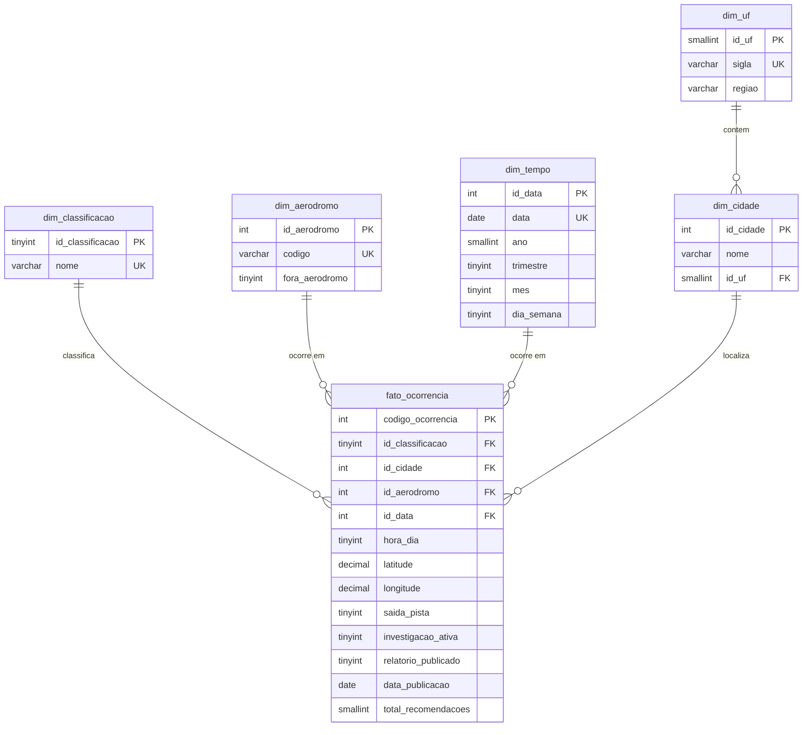

# Segurança de voo no Brasil: pipeline ETL e dashboard (CENIPA)

Projeto prático de Banco de Dados 2 (3ª série, Ensino Médio Técnico): pipeline de engenharia de dados ponta a ponta com a **Arquitetura Medalhão** (Bronze, Prata e Ouro), banco MySQL em esquema estrela, análise exploratória e dashboard.

**Integrantes:** Cauã Albano, Júlia Maria, Miguel David, Vinicius Veiga e Luan Felipe · **Turma:** 3B2 · **Disciplina:** Banco de Dados 2

## 1. Problema e pergunta de negócio

Os dados são as **ocorrências aeronáuticas na aviação civil brasileira** registradas pelo CENIPA (dados abertos do governo federal): 14.626 registros, de 01/01/2007 a 09/05/2026, com classificação (acidente, incidente grave, incidente), local, data/hora, saída de pista e situação da investigação.

**Pergunta central:** o aprendizado com os acidentes está chegando a tempo? Os acidentes não caem (cerca de 154 por ano) e, dos acidentes de 2023 a 2025, só 13% têm relatório final publicado (63 de 483). O público do dashboard é o **gerente de segurança operacional** (aeroclubes, operadores e órgãos reguladores).

## 2. Arquitetura (Medalhão)

```
data/raw/ocorrencia.csv ──► src/transform.py ──► data/silver/ocorrencia_limpo.(csv|parquet)
        BRONZE                    PRATA                         │
                                                                ▼
                      sql/schema.sql  +  src/load.py  ──►  MySQL (esquema estrela)  ──►  EDA (sql/eda_queries.sql, src/eda.py)
                                  OURO                                                  ──►  Power BI / app.py (Streamlit)
```

| Camada | Pasta / arquivo | O que faz |
|---|---|---|
| Bronze | `data/raw/ocorrencia.csv` | Arquivo original do CENIPA, sem nenhuma alteração |
| Prata | `src/transform.py` | Limpeza e tipagem. Gera `data/silver/` e o `relatorio_tratamento.txt` |
| Ouro | `sql/schema.sql`, `src/load.py` | DDL do esquema estrela e carga automática no MySQL em uma transação |
| EDA | `sql/eda_queries.sql`, `src/eda.py`, `docs/relatorio_eda.md` | Consultas, estatísticas e respostas às perguntas de negócio |
| Dashboard | `docs/powerbi_guia.md`, `app.py` | Power BI conectado ao MySQL (medidas DAX no guia) e versão Streamlit |

## 3. Como executar

```bash
python -m venv .venv && source .venv/bin/activate     # Windows: .venv\Scripts\activate
pip install -r requirements.txt
cp .env.example .env                                  # preencha usuário e senha do MySQL

python src/transform.py      # Bronze -> Prata (reexecutável do zero)
python src/load.py           # Prata -> Ouro (cria o banco, as tabelas e carrega)
python src/eda.py            # estatísticas descritivas
streamlit run app.py         # dashboard Streamlit (usa a camada Prata)
```

Requisitos: Python 3.10+ e MySQL 8+ (o `schema.sql` usa `CHECK`).

## 4. Camada Prata: tratamento aplicado

Resumo (detalhes em `data/silver/relatorio_tratamento.txt`):

- Texto em MAIÚSCULAS e sem espaços sobrando; marcadores como `***`, `NULL` e vazio viram nulo.
- Colunas `codigo_ocorrencia1..4` eram cópias idênticas do código principal e foram removidas.
- Duplicidades: 0 encontradas (conferidas por linha completa e por código).
- Datas em ISO-8601; SIM/NÃO viram 1/0; números convertidos; latitude com sinal perdido (`?19.33`) corrigida.
- UF ausente vira `NÃO INFORMADO` (25 casos). Coordenadas ausentes (4.422) e hora ausente (2) ficam nulas, sem imputação.
- Outliers: 146 coordenadas fora do Brasil anuladas; 117 ocorrências com muitas recomendações (IQR > 6) e 1 com zero aeronave apenas sinalizadas.

## 5. Camada Ouro: modelo relacional

Fato `fato_ocorrencia` (1 linha por ocorrência) e dimensões de classificação, aeródromo, tempo e localização (cidade → UF, em snowflake).



Restrições aplicadas: PK em todas as tabelas, `NOT NULL`, `UNIQUE` nas chaves naturais, 5 `FOREIGN KEY` e `CHECK` de faixa para latitude e longitude. O `load.py` carrega tudo em **uma transação** e confere se a contagem da fato é igual à da Prata.

## 6. Análise exploratória

Relatório completo em [`docs/relatorio_eda.md`](docs/relatorio_eda.md): 5 perguntas de negócio, cada uma com a consulta SQL e a conclusão. Principais achados:

1. Acidentes ficam entre 103 e 205 por ano, sem tendência de queda desde 2011.
2. O relatório final é o gargalo: 92% dos acidentes de 2019 têm relatório e só 13% dos de 2023 a 2025.
3. SP, MT e RS lideram em acidentes; 62% dos acidentes ocorrem fora de aeródromo (FAER).
4. SBBI, SBJD, SBNV e SBBP são os aeródromos com mais saídas de pista.
5. Os incidentes não graves saltam de 393 (2022) para 2.456 (2024). Parece mudança de registro, não de risco.

## 7. Dashboard

- **Power BI (exigido pelo guia):** conexão ao MySQL, relacionamentos, medidas DAX e layout em [`docs/powerbi_guia.md`](docs/powerbi_guia.md).
- **Streamlit (`app.py`):** KPIs com semáforo e ação associada, tendências e detalhamento, seguindo a Atividade 3 de Dashboards. A aba **MVP: Briefing pré-voo** mostra o histórico de ocorrências por aeródromo e horário para o operador.

## 8. Uso de IA generativa

Registro dos prompts em [`docs/prompts_ia.md`](docs/prompts_ia.md). Todo código gerado com apoio de IA foi lido, executado e corrigido pelo grupo, que é responsável pelo resultado.

## 9. Limitações

- Contagens históricas, sem ajuste pelo volume de voos: aeródromos movimentados têm mais registros.
- O prazo de publicação dos relatórios só pode ser medido nos relatórios já publicados, o que subestima o atraso dos casos recentes.
- 2026 é ano parcial (dados até 09/05/2026).
- Não foi usada API externa de enriquecimento (ViaCEP) nem GeoPandas: a base já traz UF e coordenadas, e não há malha territorial no projeto.

## Fonte dos dados

CENIPA (Força Aérea Brasileira), *Ocorrências Aeronáuticas na Aviação Civil Brasileira*, dados abertos do governo federal.
